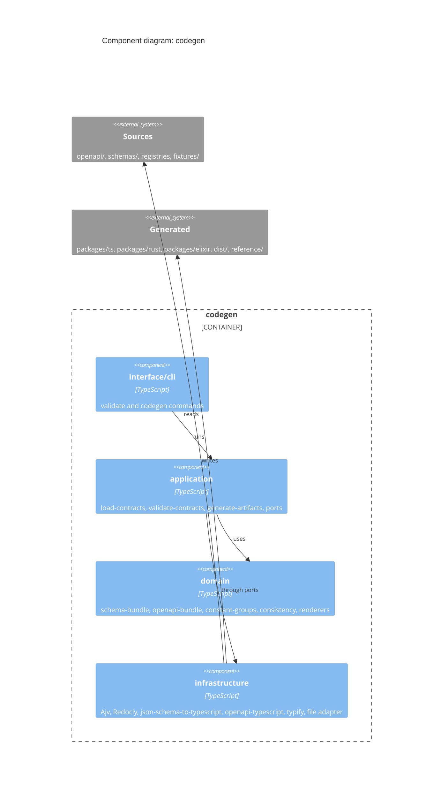

# Architecture

`contracts` is a build-time pipeline. Sources are validated, bundled into one schema graph keyed by schema
title, then rendered by one renderer per target. Domain code (bundling, naming, constant model, renderers) is
pure; filesystem, Ajv, Redocly, typify and `mix format` sit behind ports in `infrastructure/`.

## Rules

- `codegen` validates first and refuses to generate from invalid sources.
- Generated directories are replaced wholesale on each run, so stale files cannot linger.
- CI regenerates and fails on any git diff, which keeps committed artifacts in sync with the sources.
- Each schema has a unique `title`; that title is the type name in every language.
